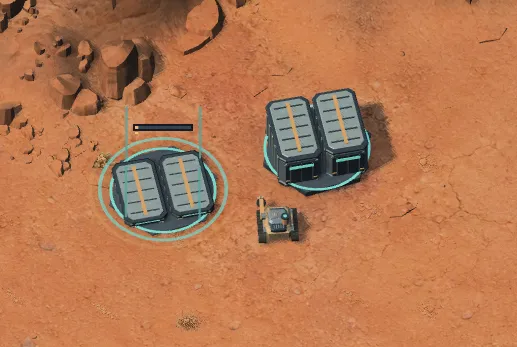

# Navigation: Worker, Gruppenankunft und Liveness

## Nutzerberichte

Beim nacheinander gesetzten rechten/linken Logistics depot blieb der zweite Worker stehen; Karte/Seed/Position fehlen. Zweiter Bericht: zwei stehende Prospector zwischen HQ/Gebäude nahe Mineralfeld, ohne Zustandsabzug.

Isolierte HQ-/Depot-Prüfung belegte eine passende Fehlerklasse: wechselndes HQ-/Servicepunktziel und vorzeitig übersprungener Arbeitswegpunkt. Korrektur integriert, Originalscreenshots nicht exakt reproduziert. [Navigationsregressionen](../../../tests/ashes-of-meridian-navigation.check.cjs), [dauerhafter Vertrag](../../architecture.md#welt-darstellung-und-zufall).

## Noch offen

- [ ] Die vier `worker traffic stays productive for six minutes`-Fälle mit den entwickelten Basen klären: Seeds/Faktionen 1409/0 (acht Worker, freie und erzwungene Knotenzuweisung), 7012/1 und 9017/2 (je zwölf Worker) scheitern bereits an fehlendem Abbaufortschritt einzelner Worker in der ersten Minute. Gezielte Gegenprobe für 1409/0 mit erzwungenem Knoten: Worker 63 bei (90.035, 112.291), Minenauftrag auf Ressource 24, Fracht 0, leerer Pfad, Stuck 3.05. Fixturebelegung und tatsächliche Navigation getrennt untersuchen; weder Anlaufgrenze noch Lieferpflicht abschwächen.
- [ ] Originalfälle bei erneutem Stillstand sichern: Karte/Seed, Workerposition/-auftrag/-fracht, Exit/Yield, kompletter Pfad samt Ziel/Status/Version, Stuck-/Recoverywerte und Nachbargeometrie. Vor Reload sichern; kein laufendes Restore.
- [ ] Sichtbarer Blockiert-/Ausgangswarten-Status oder abschließende Fehlerreaktion. Temporäre Belegung nicht als dauerhaft unerreichbar behandeln; keine heimlichen Erstattungen/Teleports.
- [ ] Auftragsweite Liveness statt nur Wegpunktfortschritt, Yield-/Umwegzyklen und Servicepunkt-Fairness/Gegenverkehr beurteilen.
- [ ] Größenabhängige Clearance, allgemeine Segmentkollision und globales Suchbudget nur als separate Erweiterung. Bestehende Radien/RNG schützen. Kosten von Wegsuche und Live-Körperprüfungen stehen zentral unter [Performance](../performance/README.md#bewegte-armeen-und-navigation); reine Beschleunigung ersetzt keine Liveness-Abnahme.

Akzeptanz: erreichbarer Bau wird ohne Neuauftrag abgeschlossen, jeder erreichbare Minenworker liefert wiederholt; unerreichbare Ziele sind nachvollziehbar ohne Suchstürme. Höhenzugang darf Arbeit durch Klippen nicht erlauben.

Bestehende Langlauf-Ausnahme für künstlich gebündelte Startworker: erste Anlaufminute nur mit Abbaufortschritt, danach weiterhin Lieferung je Worker/Minute. Keine allgemeine Stillstandstoleranz. Crowd-/Originalfallabnahme bleibt offen; [Prüffreigaben](../../testing.md).

## Gruppenankunft und Ausweichwackeln

Der Nutzer meldete sehr lange Gruppenankunft, fortgesetztes Hin-und-her-Bewegen vieler Einheiten und eine bis zum Aufnahmeende bewegte Einheit. Annähernd 60 FPS in derselben Chromium-Aufnahme belegen keine korrekte Zielankunft. Die aggregierte Performanceaufnahme enthält keine Einzelpositionen, Befehls-/Zielmarker oder Recoveryzustände; konkrete Ursache und betroffene Einheit bleiben offen. Die jüngste positive FPS-Rückmeldung ist keine bestätigte Behebung dieses Verhaltens.

- [ ] Bei erneutem Auftreten Spielstand/Karte/Seed, Einheiten-IDs, ursprünglichen Gruppenbefehl und Formationsziele sichern. Je betroffener Einheit Position, Auftrag, Pfad/Ziel/Status/Version, Wegpunkt, Stuck-/Recovery-/Yieldzustand und nahe Körper/Ausgänge vor Reload erfassen.
- [ ] Einzel- gegen Gruppenankunft, freies gegen belegtes Ziel sowie tatsächlich blockierte Engstelle unterscheiden; Ankunftstoleranz, Formationsplatz und wiederholtes Ausweichen/Neuplanen getrennt beurteilen.

Keine vorsorgliche Änderung an Radien, Zielabständen, Formation, Yield-Prioritäten oder Recovery. Reproduktion und begrenzte Verhaltensregression benötigen einen eigenen Auftrag; schnelleres Rendering oder ein Körperindex ist kein Nachweis einer Behebung.
